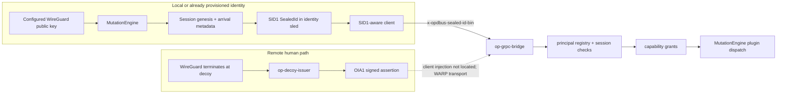

# Identity and Transport

The identity subsystem owns identity minting, session anchoring, and the
MutationEngine-authored SealedId envelope. A SealedId is a `SID1` credential;
it is separate from an `OPBLOB01` plugin blob. Plugin blobs define the plugin
catalog. SID1 binds one registered WireGuard-derived principal to one anchored
session and is carried unchanged to an authenticated receiver.

## Two identity paths

The owner-defined network boundary is that WireGuard terminates at the decoy
and WARP transports traffic and identity toward the server. WARP transport by
itself is not an authentication proof, and the source does not establish that
WARP injects either SID1 or OIA1. The decoy route below is the explicit source
mechanism for producing OIA1; the SID1 route is produced by the server-side
MutationEngine.

## Server-owned SID1 lifecycle

`MutationEngine::bootstrap_control_plane_chatbot_identity` and
`MutationEngine::bootstrap_configured_local_human_identity` derive the session
and principal IDs from the configured WireGuard public key, register the key in
the `human_principal` registry when needed, and call
`MutationEngine::mint_and_store_genesis`.

The current bootstrap requires the provisioned identity record to be recovered
from the configured durable store first. It does not invent an Incus instance
when none exists. The singleton chatbot process's first-arrival binding remains
an owner decision tracked in OD-58.

- [mutation_engine.rs](../../../crates/op-grpc-bridge/src/mutation_engine.rs)
  (`bootstrap_*_identity`, `ensure_verified_human_session_context`,
  `mint_and_store_genesis`).
- The genesis stamp includes the session ID, public key, chain head, catalog
  hash, trace ID, and arrival time. The session arrival is anchored only after
  the verified identity path permits it.
- `sealed_sealed_id` constructs `op_identity::sealed_id::SealedId` with
  `principal_kind = "wireguard-principal"` and transport scope
  `dbus,grpc,mcp`, then calls `to_inline_ref`.
- [sealed_id.rs](../../../crates/op-identity/src/sealed_id.rs) defines the
  fixed `SID1` wire format: bounded fields followed by a SHA-256 integrity
  trailer. Its inline sled spelling is `sid1:<base64url>` and its binary HTTP
  and gRPC metadata name is `x-opdbus-sealed-id-bin`.
- [identity_sled_dispatch.rs](../../../crates/op-grpc-bridge/src/identity_sled_dispatch.rs)
  persists `sealed_id` with the identity session. An anchored session keeps its
  authored SID1; callers cannot supply or replace it.

The client rule is possession and forwarding: read the selected sled's exact
SID1, validate that its claims still match the projection, and forward the
authored bytes using the transport's encoding. [session_projection.rs](../../../crates/op-identity/src/session_projection.rs)
implements `mcp_sealed_id_header`; [op-identity-headers.rs](../../../crates/op-identity/src/bin/op-identity-headers.rs)
emits the JSON header object consumed by a direct HTTP/MCP header helper. A
client must not derive a new SID1, rebuild claims, hash a footprint, or mint a
replacement credential.

| Surface | Credential representation |
|---|---|
| Stored identity sled | `sealed_id: sid1:<unpadded-base64url>` containing the SID1 binary envelope. |
| Direct HTTP/MCP | `x-opdbus-sealed-id-bin` contains the canonical base64url payload without the `sid1:` prefix; the helper forwards it unchanged. |
| Native gRPC | Binary metadata under the same name carries decoded SID1 bytes. Tonic's `MetadataValue::from_bytes` handles gRPC's wire encoding; inserting the HTTP header text as binary bytes would double-encode it. |
| D-Bus | Credential bytes are supplied to `RegisterCurrentSender`; subsequent calls use the authenticated bus-sender binding. This is not an HTTP header on every D-Bus call. |

The SHA-256 trailer detects changes to the envelope; it is not an issuer
signature. Authentication requires the receiver's exact match to the
authoritative anchored sled and current principal registration. SID1 is
reusable within the session's valid term; OIA1 has a separate one-use nonce.

## OIA1 decoy assertion path

OIA1 has a different role. It is a short-lived Ed25519 assertion that lets the
server authenticate a remote human arrival before that human's anchored session
context is available. [op-decoy-issuer.rs](../../../crates/op-identity/src/bin/op-decoy-issuer.rs)
runs on the decoy, reads the connection source address on its WireGuard inner
listener, and resolves that address to one exact `/32` or `/128` `wg show`
allowed-ips entry. It then uses `DecoyIssuer::issue` to return an OIA1 wire
envelope. The source file documents that the decoy is the sole WireGuard
termination point and that the resulting assertion is carried as
`x-oracle-identity-assertion-bin`.

The bridge's [oracle_assertion.rs](../../../crates/op-grpc-bridge/src/oracle_assertion.rs)
validates OIA1 framing, the configured decoy key ID and Ed25519 signature,
time bounds, replay nonce, configured source binding, and the registered human
principal. It then calls
`MutationEngine::ensure_verified_human_session_context`, which anchors or
recovers the server-owned session context. OIA1 is therefore an arrival proof;
it is not the SID1 envelope and it does not become a plugin blob.

Production's default source-binding mode is `trusted-decoy-signature`, so the
signature and trust store remain authoritative when WARP/Xray changes the TCP
source address. `exact-peer-ip` is an explicit legacy/test mode. This setting
does not prove the health or correctness of a WARP tunnel.

## Admission and dispatch

All three server surfaces converge on the same identity and authorization
invariants:

- **Plugin gRPC/gRPC-Web:** [interceptor.rs](../../../crates/op-grpc-bridge/src/interceptor.rs)
  accepts exactly one OIA1 or SID1 credential. SID1 is opened and matched to
  the authoritative sled, then the active principal registry is checked.
  Missing, malformed, expired, mismatched or revoked credentials are rejected;
  OIA1 also rejects a consumed replay nonce. The generated method path requires the schema's declared
  capability, a matching `x-opdbus-capability` header, and an exact principal
  grant in [grpc_server.rs](../../../crates/op-grpc-bridge/src/grpc_server.rs).
- **D-Bus:** D-Bus does not pass through the gRPC interceptor. The
  `DbusIdentityV1.RegisterCurrentSender` method accepts a SID1 or OIA1 payload,
  binds the proof to the bus-assigned sender and process credentials, checks the
  identity binding grant, and records the sender binding in
  [dbus_identity.rs](../../../crates/op-grpc-bridge/src/dbus_identity.rs).
  Later `PluginV1` calls revalidate that binding before dispatch.
- **MCP:** the unified `:8090/mcp` HTTP handler accepts either OIA1 or SID1,
  rejects both or neither, and for SID1 requires an exact MCP grant plus a
  registered, non-revoked principal. The handler is in
  [mcp_frontend.rs](../../../crates/op-grpc-bridge/src/mcp_frontend.rs).

StateSync and EventChain now use the strict credential interceptor alongside
PluginService. Their handlers enforce operation-specific authority. Public
state reads select sealed public SHM; private UI workspace reads additionally
require the owner's current session, exact `gemma.read` grant, pinned contract
and explicit activation/recovery. The private stream rechecks admission while
delivering committed jobs/specs descendants, including after lag and deletion.

OvsdbMirror, RuntimeMirror, ComponentRegistry, Mail, PrivacyNetwork,
DbusPassthrough and dedicated Chat still use the legacy interceptor in
`grpc_server.rs`. Their authentication and per-operation authority need separate
assessment; accepting SID1 at PluginService does not establish a uniform gate
across every legacy service.

After admission, gRPC `PluginService.CallMethod` and generated plugin methods
call `MutationEngine::dispatch_method_call_with_identity`. The bridge is a
transport and authorization adapter; plugin behavior remains behind the
MutationEngine and the D-Bus/plugin schema path.

## Built-in client repair and remaining transport work

The native plugin client in [grpc_client.rs](../../../crates/op-grpc-bridge/src/grpc_client.rs)
requires an explicit identity session selector, reads the private credential
projection, validates its authored claims and forwards the exact decoded SID1
bytes. The request also carries the schema-declared capability metadata.

The [HTTP adapter](../../../crates/op-web/src/handlers/tched_router.rs) accepts
exactly one bounded canonical SID1/OIA1 header and forwards the caller's bytes.
It does not fall back to the server's identity. Legacy non-plugin service
interceptors remain unchanged. The new built-in-client TLS fixture exercises
receiver acceptance, rejection of reconstructed/missing/dual credentials and
principal grants. Current full formatting/Clippy/workspace-test receipts and
remaining gaps are recorded on [OD-58](../../../WISHLIST.md); earlier passing
counts do not identify the latest checkout.

The decoy issuer and OIA1 receiver already exist. This repair provides forwarding
for a caller-supplied assertion; it does not add a client that fetches
`/assertion` from the decoy. Remote acquisition and end-to-end WARP delivery
remain separate OD-34 work and have not been validated against live systems.

## Source proof

Meaningful tests cover the credential boundaries and identity ownership:

- `sealed_id::tests::sid1_round_trips_deterministically` and
  `sid1_rejects_tampering_and_trailing_bytes`.
- `identity_sled_dispatch::tests::parked_anchored_sled_authenticates_sid1` and
  `callers_cannot_write_mutation_engine_sealed_id`.
- `session_projection::tests::mcp_header_forwards_exact_sled_sealed_id_and_rejects_projection_drift`.
- Interceptor tests for parked SID1 authentication, current principal
  registration, and rejecting OIA1 plus SID1 together.
- OIA1 validator tests for unknown keys, signature, lifetime, source binding,
  replay, and registry failure behavior.

The pre-repair source verification gate was 1,126 passed, zero failed,
and eight ignored. Its fingerprints are historical and do not identify the
repaired source. A separate
[local metadata observation](topology-observation.json) found two protected
identity records, both with an inline `sid1:` value, genesis and instance
binding. Only aggregate counts were retained; credentials were not printed.
Presence does not prove integrity validation, transport injection or receiver
acceptance. Decoy operation, WARP delivery and deployed binary equivalence
remain unverified.
