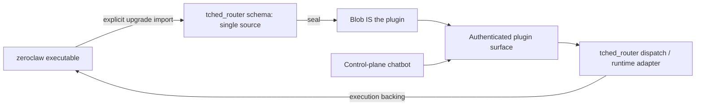

# System Overview

This map describes the **2026-09-14 working tree**, based on commit
`1b82c594acd8d17a7e1b64b1b6ba52a21e5d9e97` plus existing uncommitted changes.
Three source readers and a coordinating integration pass produced it. It records
source evidence and owner intent separately; it does not certify deployed state.
See the explicitly historical [Plugin Execution Baseline](plugin-baseline.md) for
the registration inventory captured by the learning pass and the
[tched_router trace](tched-router-baseline.md) for schema-to-backend evidence.
Recheck either against current source before treating a recorded method status as
current. See the [Crate Map](crate-map.md) for inventory and
[Documentation Maintenance](../contributors/doc-maintenance.md) for refreshing it.

## Nonnegotiable source-of-truth rule

**Owner clarification, 2026-09-13: the plugin IS the schema. That one source is
sealed into the blob, which IS the plugin. There must be no separate `schemas/`
directory holding parallel schema sources.** Extracting a contract from a backing
binary must feed this single plugin definition; it does not authorize another
schema store. Generated transport views are derivatives of the plugin contract,
not independent authorities.

The historical baseline records the former schema capture files and includes.
The repaired source keeps one
`tched_router_contract.rs` plugin-owned import, derives 81 section schemas and
89 configuration methods from it, and removes the `schemas/` directory. The
recorded 1,132-test formatting/Clippy/workspace gate predates the current
repairs. The root final gate, a clean repository, and a prepared snapshot remain
separate validation steps; this map does not certify installed binaries or a
live catalog.

The canonical Rust contract type is `PluginSchema`, defined in
[`plugin_schema.rs`](../../../crates/op-state-store/src/plugin_schema.rs)
(`MethodDecl`, line 126; `PluginSchema`, line 252). Plugins expose typed methods,
capabilities and metadata. Sealed blobs carry those contracts into runtime
discovery. The bridge exposes authenticated D-Bus, gRPC and MCP surfaces backed
by shared dispatch. A plugin may use an external executable as its implementation;
that relationship is part of the architecture even when Cargo has no dependency
on an upstream framework crate.

## Binary-backed tched_router

**Owner clarification, 2026-09-13:** 3tched-router / tched-router is the
framework/schema/plugin integration, identified as `tched_router` in code. The
upstream executable keeps the name `zeroclaw`. Its own extracted configuration
schema must feed the single plugin contract; the system uses the plugin with binary
backing. Assistant is the **control-plane chatbot**, not an assistant container.
The historical Gemma routing role is intended to be **model agnostic**. Waypipe
is retired; its crate, Cargo target and protocol are absent.



The diagram combines schema derivation and execution. Current source follows
the single-contract path below:

| Step | Source evidence |
|---|---|
| Historical capture: pre-repair evidence | The `schemas/` tree and file includes were removed; Git history and the explicitly historical baseline retain the prior evidence. |
| Current contract import | [`tched_router_contract.rs`](../../../crates/op-plugins/src/state_plugins/tched_router_contract.rs) imports the upstream contract once; 81 derived section schemas and 89 configuration methods are generated from that plugin-owned value. |
| Explicit generator boundary | [`gen_tched_router_config_surface.rs`](../../../crates/op-plugins/src/bin/gen_tched_router_config_surface.rs) regenerates derived Rust and accepts an explicit upstream import; it does not perform a runtime schema lookup. |
| Native release input | [`vendor/tched-router/source.pin`](../../../vendor/tched-router/source.pin) and [`build-native.sh`](../../../vendor/tched-router/build-native.sh) bind the upstream archive/commit and patches to a candidate binary plus provenance manifest without installing it. Golden preparation validates and stages both. |
| Assemble the plugin | [`tched_router.rs`](../../../crates/op-plugins/src/state_plugins/tched_router.rs), `tched_router_schema_from_state` (line 1597), config method registration (line 1839), and `dispatch_tched_router_method`. |
| Execute through backing runtime | [`mutation_engine.rs`](../../../crates/op-grpc-bridge/src/mutation_engine.rs) sends router operations through [`TchedRouterRuntimeClient`](../../../crates/op-grpc-bridge/src/tched_router_runtime.rs). Selection writes and verifies upstream configuration before publishing projection changes. The runit owner verifies the staged native manifest, commit, binary digest and version before executing `/usr/bin/zeroclaw`. |

The imported contract records binary version 0.8.4. Consolidation preserved the
contract and all 81 derived section documents. Generator and final root gates
must establish current source equivalence; this map does not prove live catalog
or running binary parity.

## Schema, discovery and execution

1. **Declare:** plugin files under `crates/op-plugins/src/state_plugins/` define
   typed contracts. `method_decl_from_schemars_with_output` in
   [`plugin_scaffold_helpers.rs`](../../../crates/op-plugins/src/state_plugins/plugin_scaffold_helpers.rs)
   derives request/response schemas. Each plugin module emits an inventory
   registration; the registry in
   [`default_registry.rs`](../../../crates/op-plugins/src/default_registry.rs)
   consumes these registrations to instantiate implementations. The registry
   is not live presence authority.
2. **Seal:** `seal_plugins` in
   [`opblob.rs`](../../../crates/op-plugins/src/bin/opblob.rs) prefers `schema_live`
   where available. It uses the [`op-blob` library](../../../crates/op-blob/src/lib.rs)
   and [`ActiveReflectionCatalog`](../../../crates/op-blob/src/catalog.rs) to write the catalog,
   commit the manifest last, and sweep absent plugin IDs. The executable belongs
   to `op-plugins`. A build by itself does not establish catalog parity.
3. **Generate:** bridge [`build.rs`](../../../crates/op-grpc-bridge/build.rs)
   derives `plugin_methods.proto`, `plugin_method_routes.rs` and descriptors from
   nonempty schema method sets. These are build outputs, not handwritten plugin
   service packages.
4. **Discover:** [`dynamic_reflection.rs`](../../../crates/op-grpc-bridge/src/dynamic_reflection.rs)
   intersects generated mounted services with active blobs. Descriptor metadata
   alone does not mount a handler. There is no `op-projection` crate in this
   checkout; current bridge [`server.rs`](../../../crates/op-grpc-bridge/src/server.rs)
   owns the relevant startup wiring.
5. **Dispatch:** D-Bus `SchemaBackedInterface::call`, generated typed gRPC,
   generic `PluginService::call_method`, and the MCP frontend enter the shared
   `MutationEngine::dispatch_method_call_with_identity` through their respective
   authentication/capability gates.

The repository's architectural policy names D-Bus as the control plane. Current
source uses a shared dispatcher: generated gRPC calls do **not** perform a
mandatory bus-wire round trip. Compare
[`schema_router.rs`](../../../crates/op-grpc-bridge/src/schema_router.rs), line 766;
[`grpc_server.rs`](../../../crates/op-grpc-bridge/src/grpc_server.rs), lines 712 and
1317; and [`mcp_frontend.rs`](../../../crates/op-grpc-bridge/src/mcp_frontend.rs),
line 370. Current constants in
[`canonical.rs`](../../../crates/op-plugins/src/canonical.rs) distinguish bus
destination `org.opdbus.v1.plugins`, interface `org.opdbus.v1.PluginV1`, and object
base path `/org/opdbus/v1/plugins`; old prose sometimes conflates them.

## A traceable implemented request

`snowball.verify_chain` is a useful small path for onboarding:

```text
snowball_plugin.rs: typed VerifyChain input/output and snowball.read capability
  → generated SnowballPluginMethods/VerifyChain
  → authenticated identity + exact declared capability + principal grant
  → MutationEngine::dispatch_method_call_with_identity
  → snowball arm → dispatch_snowball_verify_chain
  → EventChain::verify_range
  → domain result inside the audited dispatch envelope
```

Evidence: [`snowball_plugin.rs`](../../../crates/op-plugins/src/state_plugins/snowball_plugin.rs)
(line 513), [`mutation_engine.rs`](../../../crates/op-grpc-bridge/src/mutation_engine.rs)
(lines 2347 and 2970), [`event_chain.rs`](../../../crates/op-state-store/src/event_chain.rs)
(`verify_range`, line 764), and
[`accountability_audit_trail.rs`](../../../crates/op-grpc-bridge/tests/accountability_audit_trail.rs)
(line 164).

The dispatcher returns `event_id`, `event_hash` and nested `result`. Typed gRPC
extracts the domain result before descriptor encoding; generic `PluginService`
returns the full envelope inside its `result`; MCP extracts the domain result.
Accurate output schemas therefore matter even when a generic JSON call appears
to work. See `grpc_server.rs` lines 732 and 1334 and `mcp_frontend.rs` line 380.

## Identity, storage and retrieval

The [Identity and Transport trace](identity-transport.md) records the exact
mint/persist/inject/validate chain and the repaired built-in gRPC client path.

- **Owner-confirmed topology (2026-09-13):** WireGuard terminates at the decoy;
  there is no WireGuard on this server. WARP transports identity. Source types
  and plugin declarations involving WireGuard must be interpreted against these
  deployment roles. Their presence does not imply a server tunnel or authorize
  adding one; missing `wgcf` handlers do not establish a failed WARP transport.
- **Identity:** [`SealedId`](../../../crates/op-identity/src/sealed_id.rs) encodes
  SID1 claims with an integrity checksum. Authentication additionally requires
  exact matching against an authoritative anchored sled and active principal
  registration. Both current native gRPC
  ([`interceptor.rs`](../../../crates/op-grpc-bridge/src/interceptor.rs), line 176)
  and MCP (`mcp_frontend.rs`, line 245) check registration/revocation. Principal
  grants are separate authority; schema grant metadata is not a grant.
- **Durability:** [`identity_sled_dispatch.rs`](../../../crates/op-grpc-bridge/src/identity_sled_dispatch.rs)
  separates cache initialization from `persist_sled_required`, which prevents
  credential creation without durable storage. The bridge cognitive path uses
  `CognitiveMcpServer::new_durable`. [`op-cozo-store`](../../../crates/op-cozo-store/src/lib.rs)
  supplies the persistent Cozo/RocksDB API. `op-state-store` also defines an
  in-memory implementation; its package name does not imply persistence.
- **Audit:** [`StreamingSnowball`](../../../crates/op-snowball/src/snowball.rs)
  writes timing records durably before optional vector attachment. Bridge audit
  initialization can fall back to RAM (`mutation_engine.rs`, line 1024), so a
  successful dispatch alone is not evidence of durable audit storage.
- **Scoped projects:** [`project_dispatch.rs`](../../../crates/op-grpc-bridge/src/project_dispatch.rs)
  combines verified sessions, principal grants and project membership. Existing
  OD-46/OD-47 still cover end-to-end execution and private push isolation;
  namespace generation alone does not establish it. In
  [`context_awareness.rs`](../../../crates/op-cognitive-mcp/src/context_awareness.rs),
  proactive queries still use `namespace_id: None` (lines 824 and 848).
- **Code retrieval:** [`code_tools.rs`](../../../crates/op-cognitive-mcp/src/code_tools.rs)
  registers `code_search`, `code_context` and `code_index` against
  [`RagPipeline`](../../../crates/op-cognitive-mcp/src/rag_pipeline.rs).
  Captured or raw source becomes chunks with paths, symbols, line spans and
  content hashes, embedded through Voyage and stored in Qdrant. This learning
  pass did not ingest source into those services or establish index freshness.

## Delivery and UI boundary

The public MCP frontend is in-process on `op-grpc-bridge` at `:8090`.
`op-web` hosts HTTP/static UI and the control-plane chatbot's compact mode.
Its real entrypoint chooses `routes::create_router`; the external UI is served
with `ServeDir` in [`routes/mod.rs`](../../../crates/op-web/src/routes/mod.rs)
(line 291). The owner-designated UI checkout is `/srv/git/vercel-json-render-ui`.

**Owner clarification: there is no deployment script. Deployment is btrfs
send/receive of the prepared snapshot.** Snapshot contents and transfer evidence
define the release. Runit definitions and source lists such as
[`managed-services`](../../../deploy/runit/managed-services),
[`enabled-services`](../../../deploy/runit/enabled-services) and
[`retired-binaries`](../../../deploy/runit/retired-binaries) are evidence to
reconcile with the intended snapshot, not proof of its current contents or
deployment. Existing preparation/live-install scripts are not the deployment
authority. A [local metadata receipt](topology-observation.json) records catalog
membership and enabled service names only; it does not establish a transfer,
service health or binary/source equivalence.

## Evidence that must not be mistaken for completion

| Observation | Consequence for subsequent work |
|---|---|
| Baseline cards and fingerprints predate the current repair. | Treat their line references and source snapshots as historical evidence; revalidate against current source before using them as present facts. |
| The plugin-owned tched_router contract now feeds derived sections/methods, and the bridge loader is sealed-catalog-only. | Keep one explicit import/seal path; no plugin `schemas/` directory or JSON fallback is an authority. Current repairs still require the root final gate; a clean repository and snapshot need their own checks. |
| Canonical dispatch rejects unimplemented methods and preserves audit records for attempted calls. | Schema presence and reflection still do not establish a working backend; explicit rejection is intentional until a required implementation exists. |
| Startup consumers no longer substitute for sealing. | Prepare the source/binaries, run the explicit sealer, and then consume the sealed catalog; no automatic reseal or live-health claim follows startup. |
| `btrfs_cache.rs` already uses Cozo, while other cache modules retain SQLite; `deploy/btrfs-layout.sh` already removed the historical hierarchy. | Keep policy constraints, but use current source when determining remaining migration work. |
| Existing working-tree changes and prior SIGNALS include source-only fixes. | Compilation and tests do not establish running binary, provider, catalog or identity topology parity. |

Actionable follow-ups belong in [`WISHLIST.md`](../../../WISHLIST.md), with
observations in [`SIGNALS.md`](../../../SIGNALS.md). This map is navigation and
evidence, not a second task board.
